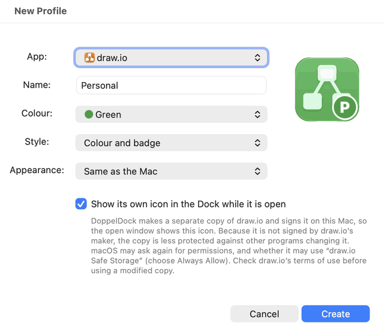
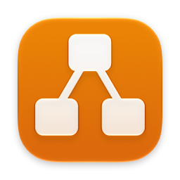
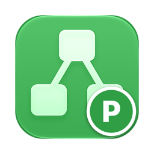
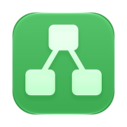
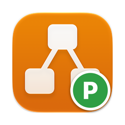
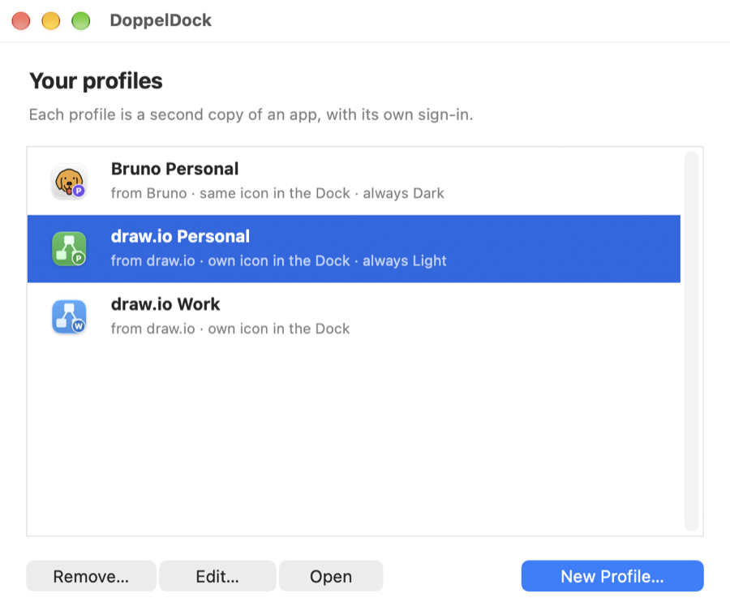

# DoppelDock

**Use two accounts in the same app on your Mac, side by side**: for example your
work and personal Slack, each in its own window, with its own sign-in and its own
coloured icon.

<p align="center">
  <picture>
    <source media="(prefers-color-scheme: dark)" srcset="docs/demo-dark.gif">
    
  </picture>
</p>

Works with apps built on Electron, such as Claude, Slack, Discord, Visual Studio
Code, Figma, Signal and draw.io. Needs macOS 12 or later, nothing else.
*Unofficial: not affiliated with the makers of these apps (see [Disclaimer](#disclaimer)).*

## Quick start

1. **Install.** Open Terminal, paste this line and press Return:

   ```bash
   d=$(mktemp -d) && curl -fsSL https://raw.githubusercontent.com/ZarinLab/doppeldock/main/doppeldock -o "$d/doppeldock" && bash "$d/doppeldock" install
   ```

2. **Make a profile.** Open **DoppelDock** from Applications, click **New Profile…**,
   pick the app, type a name such as *Personal*, and click **Create**.

3. **Sign in.** Open the new app (for example **Slack Personal**), sign in with
   your other account, then right-click its Dock icon and choose
   **Options › Keep in Dock**.

## Options

| Option | What it does |
|---|---|
| **Colour** and **Style** | Recolour the icon, add a letter badge, or both |
| **Appearance** | Always Light or always Dark, whatever your Mac is set to, so the two windows look different too |
| **Show its own icon in the Dock** | On: the open window shows the coloured icon (DoppelDock makes a copy of the app, see [Good to know](#good-to-know)). Off: nothing is modified, and the open window shows the normal icon |

| Original | Colour and badge | Colour only | Badge only |
|:---:|:---:|:---:|:---:|
|  |  |  |  |

## Managing profiles

Open DoppelDock to see your profiles. Select one to **Open** it, **Edit…** its
options, or **Remove…** it.

<p align="center">
  <picture>
    <source media="(prefers-color-scheme: dark)" srcset="docs/main-dark.png">
    
  </picture>
</p>

## Good to know

- **What's separate:** each profile has its own sign-in, settings and local
  data. Anything the app keeps elsewhere in your home folder is shared.
- **Own icon copies:**
  - macOS may ask again for permissions, and whether the copy may use
    "*App* Safe Storage". Choose **Always Allow**.
  - The copy updates itself from the original app when you open it. Don't use
    its own "Check for updates".
  - It is signed on your Mac instead of by the app's maker, so it is less
    protected against other programs changing it. A few features may not work.
- **Signing in:** prefer the app's own sign-in (email code or password).
  "Sign in with Google" and similar may send you back to the original app.
- **Removing** a profile moves it to the Trash. Its sign-in is kept unless you
  tick **Also delete this profile's sign-in and settings**.

## Update or uninstall

- **Update DoppelDock:** quit it and run the install line again.
- **Uninstall:** remove your profiles in DoppelDock, then move `DoppelDock.app`
  to the Trash.

## More

- [Details and command line](docs/details.md): every option, where files live,
  safety checks, how the copy is made, limitations.
- Related: [doppel-app](https://github.com/dotrg-31/doppel-app) does the same
  for the ChatGPT desktop app.
- Licence: MIT, see [LICENSE](LICENSE).

## Disclaimer

DoppelDock is not affiliated with, endorsed by or supported by the makers of any
app it works with. App names are trademarks of their owners. Check each app's
terms of use before using it, especially the own icon option, which makes a
modified copy of the app. You are responsible for how you use this tool.
